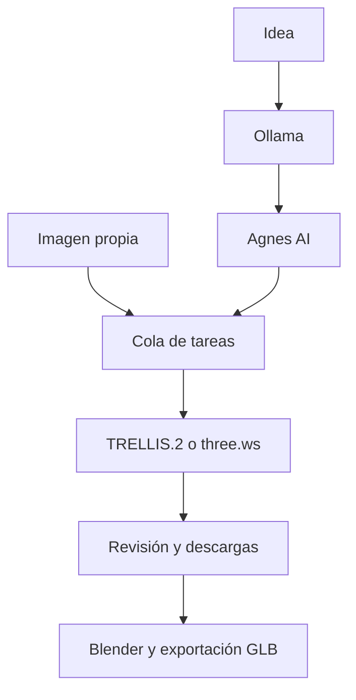

# Stylizer · Herramienta 3D de AlasTheo

> **Función en el ecosistema:** herramienta privada auxiliar para generar y preparar modelos 3D destinados a la experimentación de AlasTheo. No es otro videojuego ni sustituye la producción validada de [ALTH-META](https://github.com/Klymapo/alth-meta).

**Mapa del trabajo:** [`alth-meta`](https://github.com/Klymapo/alth-meta) = especificaciones, modelos aprobados y auditoría; **Stylizer** = generación/preparación experimental; [`peso-de-los-nombres`](https://github.com/Klymapo/peso-de-los-nombres) = juego Godot consumidor de assets. Las integraciones se realizan mediante revisión y exportación, **no hay publicación automática a los otros repositorios**.

[Guía de integración y límites](docs/ALASTHEO_TOOLCHAIN.md).

## Pipeline 3D · De una idea a un modelo 3D

> Pipeline modular que convierte una idea o una imagen en un modelo 3D (`.glb`) para refinar en Blender, priorizando opciones gratuitas sujetas a disponibilidad.

**Modular · Local + Nube · Windows · Sin pagos integrados**

## Contenido

1. [Descripción general](#1--descripción-general)
2. [Arquitectura](#2--arquitectura)
3. [Requisitos](#3--requisitos)
4. [Instalación](#4--instalación)
5. [Configuración de claves](#5--configuración-de-claves)
6. [Uso](#6--uso)
7. [Interfaz web (Gradio)](#7--interfaz-web-gradio)
8. [Estructura del proyecto](#8--estructura-del-proyecto)
9. [Límites y gratuidad](#9--límites-y-gratuidad)
10. [Solución de problemas](#10--solución-de-problemas)
11. [Roadmap](#11--roadmap)
12. [Créditos](#12--créditos)

---

## 1 · Descripción general

Este proyecto implementa un pipeline en cuatro capas que transforma una idea textual en un modelo 3D descargable:

```text
Idea (español) → Prompt técnico (inglés) → Imagen 2D → Modelo 3D (.glb)
```

Cada capa es independiente y sustituible: si una API gratuita desaparece o cambia sus condiciones, solo se reemplaza ese componente sin tocar el resto.

**Filosofía del proyecto:** priorizar herramientas locales y capas gratuitas, modularidad y uso personal recurrente. Los proveedores pueden cambiar cuotas y condiciones; la app no realiza pagos.

---

## 2 · Arquitectura



La web comparte una cola SQLite entre dispositivos. Un trabajador procesa una tarea a la vez; la página consulta su estado sin mantener abierta la sesión que la inició. MeshForge3D y la reconstrucción multivista siguen pendientes.

---

## 3 · Requisitos

- Python 3.11 o 3.12. El contenedor usa 3.11 por compatibilidad con el módulo de Blender 4.5.
- Windows 10/11, Linux o macOS; el lanzador `.bat` está pensado para Windows. La verificación automatizada de esta entrega se hizo en Linux.
- Internet para los proveedores de generación y el enlace remoto temporal.
- Una clave de Agnes **solo si partes de texto**. Ollama se utiliza en el modo `ollama`; el modo `template` prepara una composición básica sin él. Una imagen existente evita ambos pasos.
- Un token de Hugging Face si el Space lo requiere para tu cuenta.
- Blender 4.5 LTS **solo para la preparación de Godot**. No se necesita para consultar el estado o descargar resultados.

No necesitas Node.js ni servidores MCP para este flujo.
### Hardware mínimo recomendado

| Componente | Mínimo | Recomendado |
|---|---:|---:|
| RAM | 8 GB | 16 GB |
| Disco libre | 10 GB | 20 GB |
| GPU | No necesaria | 6 GB VRAM (para MeshForge3D) |

---

## 4 · Instalación

### 4.1 · Descargar el proyecto

```powershell
git clone https://github.com/Klymapo/stylizer.git
cd stylizer
```

Si ya tienes el repositorio, entra en su carpeta y actualiza la rama que estés usando. Para probar un pull request antes de integrarlo, cambia a la rama indicada en él.

### 4.2 · Entorno y dependencias

```powershell
python -m venv .venv
.venv\Scripts\python.exe -m pip install -r requirements.txt
```

En los comandos siguientes, usa `.venv\Scripts\python.exe` en Windows o `.venv/bin/python` en Linux/macOS en lugar de `python`. También puedes activar ese entorno antes de continuar.

### 4.3 · Instalar Ollama

Descarga el instalador desde [ollama.com/download/windows](https://ollama.com/download/windows) o instálalo vía PowerShell:

```powershell
irm https://ollama.com/install.ps1 | iex
```

Descarga el modelo de estilización según tu RAM:

```powershell
# 8–15 GB de RAM
ollama pull qwen2.5:3b

# 16 GB o más
ollama pull qwen2.5:7b

# Menos de 8 GB
ollama pull qwen2.5:1.5b
```

Verifica la instalación:

```powershell
ollama run qwen2.5:3b "test"
```

---

## 5 · Configuración de claves

Copia `.env.example` a `.env` una sola vez y edítalo:

```powershell
Copy-Item .env.example .env
notepad .env
```

| Variable | Para qué sirve |
|---|---|
| `AGNES_API_KEY` | Imagen desde texto; se obtiene en Agnes AI |
| `HF_TOKEN` | Acceso a Hugging Face, si tu cuenta lo necesita |
| `STYLIZER_PROMPT_MODE` | `ollama` para estilización local o `template` para texto sin un LLM local |
| `OLLAMA_MODEL` | Modelo local; por defecto `qwen2.5:3b` |
| `OLLAMA_URL` | API local, por defecto `http://localhost:11434/api/chat` |
| `STYLIZER_USER` | Usuario web; por defecto `atatoriz` |
| `STYLIZER_PASSWORD` | Contraseña web de al menos 8 caracteres para acceso remoto |
| `STYLIZER_PORT` | Puerto web; por defecto `7860` |
| `BLENDER_PATH` | Ruta a Blender si no se detecta automáticamente |
| `STYLIZER_DATA_DIR` | Cola, entradas y registros; por defecto `.stylizer` |
| `STYLIZER_OUTPUT_DIR` | Resultados; por defecto `outputs` |

Las variables del sistema tienen prioridad sobre `.env`. Este archivo queda excluido de Git. Las rutas relativas se resuelven desde la carpeta del proyecto. Mantén datos y resultados en carpetas distintas.

Comprueba la instalación sin generar imágenes ni gastar cuotas:

```powershell
python doctor.py
```

El diagnóstico muestra si las claves están configuradas, sin imprimirlas. Comprueba dependencias, detección de Blender y disponibilidad local de Ollama; no garantiza acceso o cuota de proveedores remotos.

---

## 6 · Uso

### Opción A — Pipeline completo (un comando)

```powershell
cd "C:\Users\<usuario>\pipeline3d\stylizer"
python pipeline.py "un dragón de juguete con estilo cartoon"
```

También puedes partir de una imagen existente, sin Ollama ni clave de Agnes:

```powershell
python pipeline.py --image "C:\ruta\personaje.png"
```

Usa una sola vista del personaje completo (PNG, JPEG o WebP). Si tienes un turnaround, recorta una vista para reconstruir; una hoja con varias figuras no equivale a una entrada multivista.

Cada ejecución crea una carpeta única dentro de `outputs/`:

```text
outputs/<fecha_hora_id>/
    manifest.json   # Estado, origen y archivos; también se guarda si falla
    prompt.json     # Solo cuando se parte de texto
    image.png       # Imagen utilizada para reconstruir
    model.glb       # Cuando la reconstrucción termina correctamente
    <fecha_hora_id>.zip  # Todos los resultados disponibles de esa ejecución
```

**Tiempo estimado:** 3–8 minutos.

### Opción B — Ejecutar cada capa por separado

Útil para depurar o reutilizar componentes.

#### Capa 1 · Estilizador

```powershell
python prompt_stylizer.py "un robot jardinero con estilo cartoon"
python prompt_stylizer.py --json "un dragón de juguete"  # salida JSON
```

#### Capa 2 · Imagen

```powershell
python image_generator_agnes.py "A cartoon-style robot gardener..."
```

#### Capa 3 · Modelo 3D

```powershell
# TRELLIS.2 vía Hugging Face
python mesh_generator.py output_agnes.png

# three.ws (adaptador draft experimental)
python mesh_generator_threews.py output_agnes.png
```

#### Selección de proveedor y reintento

```powershell
python pipeline.py --image personaje.png --provider auto
python pipeline.py --image personaje.png --provider trellis
python pipeline.py --image personaje.png --provider threews
```

`auto` intenta TRELLIS.2 y, si falla, una vez three.ws (draft). Se registran los intentos en `manifest.json`; una descarga incompleta o que no sea GLB se rechaza. En la interfaz, **Reintentar tarea** crea otra ejecución usando la imagen guardada, sin repetir Ollama ni Agnes. Si ya existe una imagen, el reintento la reutiliza. Las tareas se procesan de una en una.

**Disponibilidad de three.ws:** su [documentación actual](https://three.ws/docs/3d-api) distingue la ruta gratuita de texto y las rutas de imagen que pueden requerir pago. El adaptador draft es experimental; no se garantiza acceso gratuito por imagen. Ante HTTP 402 se detiene y muestra el motivo. No incluye pagos ni cambios a niveles de pago. Si termina el tiempo de espera, el trabajo remoto puede seguir activo: espera antes de reintentarlo.

### Opción C — Interfaz web

Ver la sección siguiente.

---

## 7 · Interfaz web (Gradio)

### Página independiente de tu PC

Para usar Stylizer aunque tu computadora esté apagada, despliega la aplicación completa en un servidor. El repositorio incluye `server.py`, Docker con Blender y `render.yaml` con almacenamiento persistente. La configuración de Render propuesta requiere alojamiento de pago; no se activa automáticamente al integrar el código.

Sigue la [guía de publicación web](docs/WEB_DEPLOY.md). Una vez desplegada, tendrás una dirección HTTPS estable donde iniciar tareas, consultar el historial, ver modelos y descargar resultados desde el celular. El servidor se encarga de procesar las tareas.

Los modos siguientes siguen disponibles para ejecutar el servicio en tu propia PC.

### Acceso desde tu celular

En tu PC ejecuta:

```powershell
python app.py --mobile
```

También puedes abrir `start_mobile.bat` en Windows. Si falta `STYLIZER_PASSWORD`, la terminal te pedirá una contraseña, sin mostrarla mientras escribes. El usuario predeterminado es **atatoriz**.

1. Copia el enlace **`https://…gradio.live`** que aparece en la terminal y ábrelo en el celular.
2. Inicia sesión con el usuario y la contraseña configurados.
3. En **Estado**, consulta la etapa actual, la cola y el historial. Se actualizan cada **5 segundos**.
4. Al terminar, selecciona la tarea y pulsa **Abrir resultados** para ver el modelo, revisarlo y descargar los archivos o el ZIP.

Puedes cerrar la pestaña de la PC y volver desde el celular. **La PC y `app.py` deben seguir encendidos**: el enlace es temporal, puede cambiar al reiniciar y no convierte la aplicación en un servidor permanente.

### Acceso local o en la misma red Wi-Fi

- Solo PC: `python app.py`, luego abre `http://127.0.0.1:7860`.
- Misma Wi-Fi: `python app.py --lan`, luego abre `http://IP_LOCAL_DE_LA_PC:7860` en el celular. En Windows consulta la dirección IPv4 con `ipconfig` y permite Python en redes privadas si el firewall lo solicita. Este modo usa HTTP en tu red local; no abras el puerto del router para publicarlo.

### Generar y recuperar tareas

En **Generar**, selecciona texto o imagen y pulsa **Enviar a la cola**. La tarea queda guardada antes de empezar. Si falla el 3D, se conserva la imagen para reintentar y descargar los resultados parciales.

La cola admite 20 tareas pendientes y el historial muestra las 50 más recientes. Al reiniciar, las tareas que aún estaban en cola continúan. Una tarea que ya estaba ejecutándose queda **Interrumpida**: puedes reintentarla manualmente, porque repetir automáticamente una petición remota podría duplicar trabajo o consumir cuota. Un timeout no garantiza que el proveedor haya detenido su trabajo.

Los resultados están en `outputs/` y la base de datos en `.stylizer/`. Conserva ambas carpetas para mantener historial, archivos y entradas de reintento. No abras dos instancias usando la misma carpeta de datos. Los resultados CLI anteriores se incorporan al iniciar la web; el seguimiento en vivo corresponde a las tareas iniciadas desde la web.

### Preparar para Godot — bloque 5

1. Instala Blender 4.5 y configura `BLENDER_PATH` si `doctor.py` no lo detecta.
2. En **Estado**, selecciona una tarea que tenga GLB. Abre **Godot**; también puedes subir allí un GLB existente.
3. Indica altura en metros, giro horizontal y, opcionalmente, un objetivo aproximado de triángulos (`0` conserva la geometría).
4. Pulsa **Preparar para Godot** y consulta el avance en **Estado**.
5. Descarga el ZIP: incluye `model_godot.glb`, `model_prepared.blend`, `report.json` y la guía de importación.

Cada exportación crea una copia. Normaliza escala, centra y apoya la malla en el suelo. El reporte identifica UV ausentes, imágenes faltantes, bordes no manifold y caras degeneradas. Admite mallas estáticas: rig, animaciones y shape keys requieren revisión manual. No crea animaciones, colisiones ni retopología artística.

Por terminal:

```powershell
python prepare_godot.py "outputs/ruta/model.glb" --height 1.8 --yaw 0 --triangle-limit 0
```

Consulta [la guía de importación en Godot](docs/GODOT_IMPORT.md).

### Revisar la fidelidad del personaje

1. Abre los resultados de una tarea y entra en **Revisar fidelidad**.
2. En **Frente, perfil y espalda**, carga frente, perfil o espalda del mismo personaje. Mantén pose y proporciones consistentes.
3. Gira el modelo en el visor y compara las imágenes. Evalúa silueta, cara/cabello, ropa/accesorios, colores/materiales y perfil/espalda.
4. Marca **Coincide**, **Corregir** o **Sin evaluar**. Anota cambios concretos y los detalles que quieras conservar.
5. Pulsa **Guardar revisión y actualizar ZIP**. Se genera un registro de correcciones con la identidad del modelo, copias de las referencias y fecha. Cada revisión es independiente; las anteriores se conservan.

La revisión es manual: organiza qué conservar y qué corregir, sin modificar el GLB ni prometer una medición automática de semejanza. Las imágenes adicionales son referencias de comparación, no entradas multivista del proveedor. Reintentar con la misma imagen y los mismos ajustes puede devolver un resultado similar; las notas no se envían como instrucciones de reconstrucción.

**Decisión sobre multivista (revisada el 24 de septiembre de 2026):**

- La [aplicación oficial de TRELLIS.2](https://github.com/microsoft/TRELLIS.2/blob/main/app.py) y el esquema consultado del Space aceptan una imagen en la ruta utilizada por este proyecto.
- [TRELLIS original](https://github.com/microsoft/TRELLIS/blob/main/app.py) ofrece un modo multimagen experimental; integrarlo requeriría un adaptador propio y validar resultados con vistas consistentes.
- [three.ws](https://three.ws/docs/3d-api) documenta múltiples vistas en rutas que pueden requerir pago. No se habilitan compras ni se presupone acceso gratuito.

Por ello, este bloque incorpora comparación visual y registros de corrección. La reconstrucción multivista queda como integración posterior.

### Detener

```text
Ctrl + C
```

Hazlo en la terminal donde corre la app.

### Límites integrados

`app.py` incluye un sistema de límites por IP:

- 2 tareas nuevas por minuto
- 15 tareas nuevas por hora

Consultar el estado y descargar resultados no consumen este límite.

Ajustables en la parte superior del archivo mediante `REQS_POR_MINUTO` y `REQS_POR_HORA`.

---

## 8 · Estructura del proyecto

| Archivo | Responsabilidad |
|---|---|
| `app.py` | Web, autenticación, estado y revisión |
| `server.py` / `Dockerfile` / `render.yaml` | Alojamiento web independiente de tu PC |
| `jobs.py` | Cola SQLite, trabajador y recuperación |
| `pipeline_core.py` / `pipeline.py` | Flujo compartido y CLI |
| `prompt_stylizer.py` / `image_generator_agnes.py` | Texto e imagen |
| `mesh_service.py` / `mesh_generator*.py` | Proveedores 3D y validación GLB |
| `fidelity.py` / `artifacts.py` | Revisiones, referencias y ZIP |
| `prepare_godot.py` / `blender_prepare.py` | Preparación y reporte de Blender |
| `config.py` / `.env.example` / `doctor.py` | Configuración y diagnóstico — bloque 6 |
| `start_mobile.bat` | Lanzador web para Windows |
| `tests/` | Pruebas automatizadas |
| `outputs/` / `.stylizer/` | Archivos de trabajo locales, excluidos de Git |

---

## 9 · Límites y gratuidad

| Servicio | Tipo | Límite | Coste |
|---|---|---|---|
| Ollama | Local | Sin límite | GRATIS |
| Agnes AI | API nube | Según cuenta y condiciones del proveedor | Verificar con el proveedor |
| TRELLIS.2 (HF) | Space | Cuota ZeroGPU diaria | GRATIS |
| three.ws | API nube | Acceso draft por imagen sujeto al proveedor | Puede requerir pago; la app se detiene ante 402 |
| Gradio | Local | Sin límite | GRATIS |
| Blender | Local | Sin límite | GRATIS |

> [!IMPORTANT]
> Las cuotas dependen de la cuenta y del proveedor. Comprueba las condiciones con el proveedor; no garantizan disponibilidad. El respaldo no elimina las restricciones de acceso.

---

## 10 · Solución de problemas

### `ModuleNotFoundError: No module named 'X'`

Instala las dependencias:

```powershell
python -m pip install -r requirements.txt
```

### `ollama: command not found`

Ollama no está en el `PATH`. Cierra y abre PowerShell, o reinicia el equipo.

### `ConnectionError: Ollama no responde`

Abre otra terminal y ejecuta:

```powershell
ollama serve
```

Déjala abierta mientras usas el pipeline.

### `Missing credentials: OPENAI_API_KEY`

Algún script espera variables de OpenAI. Configúralas apuntando a Ollama:

```powershell
$env:OPENAI_API_KEY = "ollama"
$env:OPENAI_BASE_URL = "http://localhost:11434/v1"
```

### `HTTPError: 400 Client Error (Agnes AI)`

Verifica que `AGNES_API_KEY` esté configurada en la sesión actual:

```powershell
$env:AGNES_API_KEY
```

Si está vacío, configura la variable y reinicia PowerShell.

### `You have exceeded your free ZeroGPU quota`

La cuota diaria de Hugging Face se agotó. Opciones:

1. Esperar 24 h.
2. Probar el modo `auto` o el adaptador three.ws, sujeto a acceso del proveedor.
3. Instalar MeshForge3D localmente (ver Roadmap).

### Timeout con `trellis_selfhost` (three.ws)

El proveedor puede estar saturado o haber cambiado su acceso. Opciones:

1. Reintentar en otro momento.
2. Revisar el error: HTTP 429 indica cuota/saturación y HTTP 402 solicita pago. La app no realiza pagos.
3. Cambiar a MeshForge3D local.

### `cursor.exe is being used by another process`

Cursor se quedó colgado en segundo plano. Mata los procesos:

```powershell
Get-Process -Name "Cursor*" | Stop-Process -Force
```

### La app Gradio no genera URL pública

Usa `python app.py --mobile`. Si el túnel no está disponible, usa `--lan` en la misma Wi-Fi o ejecuta sin opciones para acceso local. El enlace se imprime solo si la conexión de Gradio se establece.

### El modelo 3D tiene artefactos o no se parece a la imagen

Es esperable en IA generativa. Mejoras sugeridas:

- Usa una imagen de entrada más limpia: fondo blanco y objeto centrado.
- Compara frente, perfil y espalda en **Revisar fidelidad**. La ruta actual de TRELLIS.2 usa una sola imagen.
- Revisa el reporte y refina manualmente la malla en Blender: simetría, retopología y ojos.

---

## 11 · Roadmap

### ✅ Completado

- [x] Capa 1: estilizador con Ollama local
- [x] Capa 2: generación 2D con Agnes AI
- [x] Capa 3: reconstrucción 3D con TRELLIS.2
- [x] Capa 4: orquestador CLI (`pipeline.py`)
- [x] Interfaz web con Gradio (`app.py`)
- [x] Selector de proveedor y respaldo 3D experimental
- [x] Descargas individuales y ZIP por generación
- [x] Comparación con referencias y registro de correcciones
- [x] Preparación de mallas estáticas y paquete para Godot
- [x] Configuración `.env`, diagnóstico y dependencias fijadas
- [x] Cola e historial persistente en SQLite
- [x] Consulta web desde celular, con contraseña y actualización automática
- [x] Modo servidor, Docker y configuración de alojamiento persistente
- [ ] Activar el alojamiento y verificar la URL HTTPS real

### 🔄 En progreso

- [ ] Alternativa robusta a la cuota ZeroGPU (MeshForge3D local)
- [ ] Reconstrucción multivista con un adaptador compatible (investigada; no implementada)

### ☐ Futuro

- [x] Entrada directa por imagen (sin modelo de visión ni regeneración 2D)
- [ ] Refinamiento en Blender vía MCP (simetría, retopología, materiales)
- [ ] Retopología artística, UV nuevos y optimización final para juego (reducción básica ya disponible)
- [ ] Migración a GitHub Actions (issue → modelo 3D)
- [x] Visor 3D embebido en la web con Gradio

---

### Verificación local

```powershell
python -m unittest discover -s tests -v
```

Las pruebas sustituyen las respuestas de los proveedores: comprueban entradas, cola, reinicios, acceso con contraseña, dos sesiones independientes, descargas y revisiones sin gastar cuotas. La prueba de Blender es opcional: configura `BLENDER_TEST_PYTHON` con un Python que tenga el módulo `bpy` de Blender 4.5. Esa prueba crea un GLB, lo prepara y reimporta para verificar altura, suelo, material y conservación del original. No instala `bpy` como dependencia de la aplicación. También se consultó el esquema público del Space de TRELLIS.2 sin generar modelos. Hace falta una prueba real en tu equipo para verificar credenciales, cuotas, el túnel de Gradio y la importación final en Godot; los GLB simulados de prueba no evalúan geometría ni semejanza.

## 12 · Créditos

- [Ollama](https://ollama.com)
- [Qwen 2.5](https://github.com/QwenLM/Qwen2.5)
- [Agnes AI](https://platform.agnes-ai.com)
- [TRELLIS.2](https://github.com/microsoft/TRELLIS.2)
- [Hugging Face](https://huggingface.co)
- [three.ws](https://three.ws)
- [Gradio](https://gradio.app)
- [Blender](https://blender.org)

### Licencia

Uso personal y educativo. Cada componente del pipeline tiene su propia licencia (MIT, Apache 2.0 o propietaria de cada proveedor).

---

**Documento vivo · Actualizado el 2026-09-25**


## Higiene del repositorio y archivos generados

- Código de la aplicación y scripts: mantener en Git.
- Modelos de muestra y resultados históricos **ya versionados**: conservar por ahora; revisar referencias y uso antes de moverlos o eliminarlos.
- Nuevos resultados temporales: preferir `outputs/` (ignorada por Git) o artifacts de CI; evitar seguir acumulándolos en la raíz.
- Cachés Python y datos locales de Gradio: no versionar. `.gitignore` excluye `__pycache__/` y `.gradio/`.
- Certificados, tokens y claves privadas: nunca subirlos. Si un secreto se publicó, eliminar el archivo **no** basta para revocar su exposición histórica.

Guía: [docs/REPOSITORY_HYGIENE.md](docs/REPOSITORY_HYGIENE.md). Experimentos de proporciones y anatomía chibi se mantienen en **STYLIZED**, mientras la producción de assets aprobados corresponde a [ALTH-META](https://github.com/Klymapo/alth-meta). Estos tres repositorios no son duplicados.

## Investigación anatómica consolidada

El material íntegro del antiguo proyecto experimental privado **STYLIZED** (scripts Blender, calibraciones, documentos, CSV y Excel) está preservado en [`research/alth-anatomy/`](research/alth-anatomy/README.md), separado del motor de generación 3D. Sus **12 archivos originales** fueron comparados por SHA y coinciden; los candidatos importados no se consideran aprobados para producción.
